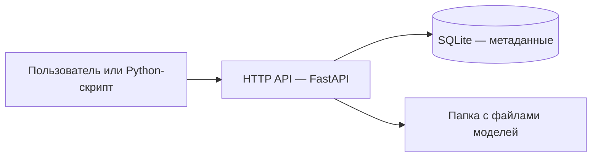
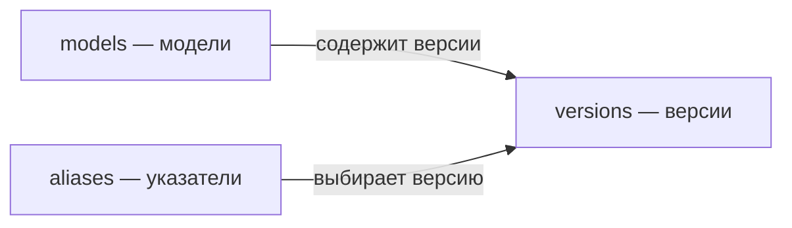

# Model registry: отчёт по проектированию

Несколько ML-команд сохраняют обученные модели в папки на общей машине. Имена папок задаются произвольно, а дополнительной информации о моделях нет. Задача проекта — организовать единый каталог моделей с версиями, метаданными и доступом через API.

## 1. Существующие проблемы

1) **Проблема: модели сложно найти и отличить друг от друга.** Команды используют произвольные названия папок. По ним нельзя надёжно определить назначение модели и её владельца.

   **К чему может привести:** потеря времени на поиск, дублирование работы и использование не той модели.

   **Как можем решить в registry:** создать единый каталог с названием модели, описанием и командой-владельцем.

2) **Проблема: неизвестно, как была получена модель.** Не сохранены сведения о датасете, версии кода, параметрах и окружении обучения.

   **К чему может привести:** результат сложно воспроизвести и установить причины различий между моделями.

   **Как можем решить в registry:** при регистрации версии сохранять параметры обучения и ссылки на конкретные версии данных, кода и окружения.

3) **Проблема: нет информации о качестве моделей.** Рядом с файлами не зафиксированы метрики и условия оценки.

   **К чему может привести:** выбор модели по названию или дате создания, без подтверждения того, что она лучше предыдущей.

   **Как можем решить в registry:** сохранять метрики каждой версии и сведения об использованных данных. Это позволит сравнивать результаты, полученные в одинаковых условиях.

4) **Проблема: нет надёжного управления версиями.** Файлы в папке можно перезаписать, а выбранная для использования версия явно не обозначена.

   **К чему может привести:** незаметная подмена модели, использование устаревшей версии и невозможность вернуться к предыдущему результату.

   **Как можем решить в registry:** выдавать каждой загрузке отдельный номер версии, запрещать её перезапись через API и хранить контрольную сумму файла. Для выбранной версии использовать переключаемый указатель `production`.

## 2. Требования и критерии приёмки

### Функциональные требования

| Требование | Критерий приёмки |
|---|---|
| Регистрация моделей | Модель содержит название и команду-владельца; описание можно добавить при создании. Сочетание `(team, name)` уникально: одинаковые названия разрешены разным командам |
| Каталог и поиск | Можно получить список моделей с фильтрацией по команде и части названия |
| Управление версиями | Каждая загрузка создаёт новую версию с последовательным номером внутри модели. Существующие версии доступны для чтения; изменить или удалить их через API нельзя |
| Хранение метаданных | Для каждой версии сохраняются библиотека обучения, ссылки на данные, код и окружение. Можно передать параметры и метрики. Эти сведения доступны через API |
| Хранение артефактов | Файл модели можно загрузить и скачать. Для него сохраняются размер и SHA-256; при скачивании проверяется целостность |
| Тегирование версий | При регистрации версии можно указать теги, например `experiment`. Теги сохраняются в метаданных; одинаковый тег может быть у нескольких версий |
| Выбор рабочей версии | Указатель `staging` обозначает версию для проверки, а `production` — выбранную для использования. Указатели можно переключать между существующими версиями той же модели |

Для работы с моделями предоставляется HTTP API с документацией и примерами запросов. Некорректные запросы возвращают соответствующий HTTP-код и описание ошибки.

### Нефункциональные требования

| Требование | Критерий приёмки |
|---|---|
| Сохранность данных | После остановки и повторного запуска сервера с тем же каталогом хранения модели, версии и файлы остаются доступны |
| Корректность одновременных записей | Параллельные загрузки одной модели получают разные номера версий и не перезаписывают файлы друг друга |
| Валидация входных данных | Проверяются обязательные поля и типы метаданных (например, указана библиотека обучения, а значение метрики является числом). Отклоняются пустые файлы и файлы, превышающие установленный лимит размера (например, слишком большой архив с весами модели). Пользователь получает описание ошибки |
| Безопасное хранение файлов | Имя файла от клиента не определяет путь на сервере. Сервис хранит артефакты без выполнения их содержимого и распаковки архивов |
| Воспроизводимый запуск и проверка | Зависимости зафиксированы, запуск описан в README. Основные операции и обработка ошибок покрыты автоматическими тестами |

## 3. Архитектура системы

Система состоит из приложения с HTTP API, базы данных и хранилища файлов моделей.



Клиент обращается к API, чтобы зарегистрировать модель, загрузить новую версию или скачать существующую. Приложение проверяет запрос и выполняет операции с БД и файлами. Клиенту не нужно отдельно записывать данные в каждое хранилище.

### Компоненты и выбор технологий

| Компонент | Технология | Назначение и обоснование |
|---|---|---|
| Приложение и HTTP API | Python, FastAPI, Pydantic | Python удобен для работы с ML-скриптами. FastAPI обрабатывает запросы и формирует документацию API, Pydantic проверяет структуру данных |
| База данных | SQLite | Хранит модели, версии и связи между ними. Не требует отдельного сервера, поэтому подходит для локального проекта. При росте системы можно использовать PostgreSQL — отдельный сервер БД, доступный нескольким экземплярам приложения |
| Хранилище артефактов | Локальная файловая система | Хранит файлы моделей без дополнительных сервисов. В большой инфраструктуре можно использовать объектное хранилище, например Amazon S3, чтобы хранить файлы независимо от серверов приложения |

Метаданные и файлы хранятся отдельно. База отвечает за поиск и связи между объектами, а файловое хранилище — за сами артефакты. В записи версии сохраняется ключ соответствующего файла.

Сервер запускается через Uvicorn. Для работы с SQLite используется стандартный модуль Python `sqlite3`: запросы и транзакции описаны явно, без дополнительного ORM. Для проверки сервиса используется pytest.

### Как происходит регистрация и загрузка

1. Клиент один раз создаёт карточку модели: передаёт команду, название и описание, получает `model_id`.
2. Клиент отправляет `model_id`, файл модели и метаданные версии одним запросом.
3. Приложение проверяет существование модели и корректность метаданных.
4. Сервер сохраняет файл под собственным именем, рассчитывает его размер и SHA-256.
5. В БД создаётся запись с номером версии, метаданными и ключом файла.
6. После сохранения записи клиент получает описание созданной версии.

Для следующих версий повторяются шаги со второго: карточку модели создавать заново не нужно. Два запроса для первой загрузки можно выполнить одним клиентским скриптом.

SHA-256 рассчитывается по содержимому файла. Результат — контрольная сумма в виде строки из 64 шестнадцатеричных символов. При скачивании сервер повторно вычисляет её и сравнивает с сохранённой. Несовпадение означает, что содержимое изменилось или повредилось; сервер возвращает ошибку. Имя файла создаётся отдельно с помощью UUID и не зависит от контрольной суммы.

Номер версии определяется внутри транзакции `BEGIN IMMEDIATE`: SQLite допускает одну запись за раз, поэтому параллельные запросы не получают один номер версии. При обработанной ошибке записи в БД транзакция откатывается, а файл этой загрузки удаляется. При аварийном завершении процесса между сохранением файла и записью в БД может остаться файл без записи: общей транзакции для SQLite и файловой системы нет.

### Перенос моделей из исходных папок

На одну версию загружается один файл. Если модель состоит из нескольких файлов, клиент предварительно упаковывает папку в архив. Сервер сохраняет архив без распаковки.

Команда заполняет известные сведения о старой модели. Если сведения о данных, коде или окружении утрачены, в соответствующих полях можно явно указать `unknown`. Registry не восстанавливает историю обучения по названию папки. Сохранение метаданных помогает воспроизводимости, но само по себе не гарантирует её.

## 4. API и схема базы данных

### API

Для работы с registry используется HTTP API. Обычные запросы с телом передают JSON. При загрузке версии файл и метаданные отправляются вместе через `multipart/form-data`: файл — в поле `artifact`, JSON-текст — в поле `metadata`.

| Метод и путь | Назначение |
|---|---|
| `POST /models` | Зарегистрировать модель: передать команду, название и описание |
| `GET /models` | Получить каталог моделей с фильтрами по команде и названию |
| `GET /models/{model_id}` | Получить карточку модели |
| `POST /models/{model_id}/versions` | Загрузить файл и метаданные новой версии |
| `GET /models/{model_id}/versions` | Получить список версий модели |
| `GET /models/{model_id}/versions/{version}` | Получить сведения о конкретной версии |
| `GET /models/{model_id}/versions/{version}/artifact` | Скачать файл версии |
| `PUT /models/{model_id}/aliases/{alias}` | Назначить версию указателю `staging` или `production` |
| `GET /models/{model_id}/aliases/{alias}` | Получить сведения о версии, на которую указывает alias |
| `GET /health` | Проверить ответ сервиса и доступ к БД |

`model_id` обозначает модель, а `version` — номер версии внутри этой модели. Фильтр `team` ищет точное совпадение команды, `name` — часть названия. Списки поддерживают `limit` и `offset` для получения данных частями.

Интерактивная документация доступна по адресу `/docs`, схема API — по адресу `/openapi.json`.

### Примеры запросов

Примеры выполняются из корня проекта при запущенном сервере. Сначала создаётся карточка модели:

```bash
curl -X POST http://127.0.0.1:8000/models \
  -H 'Content-Type: application/json' \
  -d '{"team":"mlds_1","name":"ranker","description":"Модель ранжирования"}'
```

Пример ответа с кодом `201 Created`:

```json
{
  "id": 1,
  "team": "mlds_1",
  "name": "ranker",
  "description": "Модель ранжирования",
  "created_at": "2026-10-10T12:00:00+00:00"
}
```

Затем загружаются файл и метаданные. Вместо `1` нужно подставить `id` из полученного ответа. Для проверки используются готовые файлы из каталога `examples`:

```bash
curl -X POST http://127.0.0.1:8000/models/1/versions \
  -F 'metadata=<examples/metadata.json' \
  -F 'artifact=@examples/tiny-model.json'
```

В метаданных обязательны `framework`, `dataset_ref`, `code_ref` и `environment_ref`. Дополнительно можно передать `description`, `metrics`, `parameters` и `tags`. Поле `dataset_ref` может ссылаться на описание использованных обучающей и тестовой выборок. Ссылки сохраняются как строки; сервер не проверяет доступность указанных ресурсов.

Успешная загрузка возвращает `201 Created` и карточку версии: `model_id`, `version`, `metadata`, `sha256`, `artifact_size`, `created_at`. Сам файл в JSON-ответ не включается: для его скачивания есть отдельный запрос.

Чтобы назначить первую версию на `production`:

```bash
curl -X PUT http://127.0.0.1:8000/models/1/aliases/production \
  -H 'Content-Type: application/json' \
  -d '{"version":1}'
```

Назначение указателя выполняется по желанию клиента. Оно не меняет файлы и метаданные версии и не запускает развёртывание модели. При загрузке новой версии `production` автоматически не переключается.

Основные ошибки API: `400` — пустой файл, `404` — объект не найден, `409` — дубликат имени модели в команде или повреждение сохранённого файла, `413` — превышен лимит размера файла, `422` — некорректные поля запроса. Ошибки доступности БД или хранилища возвращаются с кодом `503`.

### Схема базы данных

Используются три таблицы: `models`, `versions` и `aliases`.



| Таблица | Основные поля | Что хранит |
|---|---|---|
| `models` | `id`, `team`, `name`, `description`, `created_at` | Название, команду-владельца и описание модели |
| `versions` | `model_id`, `version`, `metadata_json`, `artifact_key`, `sha256`, `artifact_size`, `created_at` | Метаданные версии, ключ файла в хранилище, его размер и контрольную сумму |
| `aliases` | `model_id`, `alias`, `version`, `updated_at` | Соответствие между указателем и выбранной версией |

В `metadata_json` сохраняются библиотека обучения, ссылки на данные, код и окружение, параметры, метрики и теги. JSON подходит для этих данных, поскольку у разных моделей могут быть разные параметры и метрики. Через API эти данные возвращаются в поле `metadata`; внутренний ключ `artifact_key` не возвращается.

Основные ограничения БД:

- `models.id` — первичный ключ модели. Сочетание `(team, name)` уникально.
- `(model_id, version)` — составной первичный ключ версии. Поле `model_id` ссылается на существующую модель. У разных моделей нумерация версий независимая.
- `artifact_key` уникален: каждая версия получает собственный файл.
- `(model_id, alias)` — первичный ключ указателя: у модели может быть по одному `staging` и `production`.
- Внешний ключ `(model_id, version)` в `aliases` разрешает ссылаться только на существующую версию своей модели.

Типы полей и полный SQL создания таблиц находятся в `registry/schema.sql`. Основные идентификаторы, номера и размеры хранятся как `INTEGER`, описания, метаданные, ключи файлов и даты — как `TEXT`.

## 5. Реализация и проверка

Репозиторий проекта: [vsevolod-paramonov/mlops](https://github.com/vsevolod-paramonov/mlops).

Код разделён по назначению:

```text
registry/
  app.py           HTTP API и обработка ошибок
  schemas.py       Форматы запросов и ответов, валидация
  db.py            SQL-запросы и транзакции
  schema.sql       Таблицы и ограничения БД
  storage.py       Сохранение файлов и проверка SHA-256

examples/
  demo.py          Демонстрация работы через API

tests/
  test_registry.py Автоматические тесты
```

Инструкция по установке зависимостей и запуску находится в `README.md`. После запуска сервисом можно пользоваться через Python-скрипт или страницу `/docs`. База создаётся в `data/registry.sqlite3`, файлы моделей — в `data/artifacts/`.

Для демонстрации используются синтетические модели, поэтому исходные папки из условия не нужны. Скрипт `examples/demo.py` выполняет сценарий:

1. Обучает две простые модели и создаёт карточку в registry.
2. Загружает две версии с параметрами и метриками.
3. Сравнивает MAE и переключает `production` на лучшую из этих версий.
4. Скачивает выбранную версию, проверяет контрольную сумму и делает локальное предсказание.

Выбор по метрике — логика демонстрационного скрипта. Пользователь может выбирать рабочую версию вручную или вообще не назначать указатель. Сам registry не обучает модели и не выполняет предсказания.

Автоматические тесты проверяют регистрацию моделей, сохранение и скачивание файлов, создание версий, переключение указателей и обработку ошибок. Отдельно проверяются одновременные загрузки, повреждение файлов, откат при ошибке записи в БД и сохранность данных после остановки и повторного запуска сервера. Тесты используют временные БД и файлы.

Запуск тестов из корня проекта с установленными зависимостями:

```bash
python -m pytest -q
```

Реализация предназначена для локального использования. Авторизация и разграничение доступа между командами не реализованы: `team` группирует модели, но не проверяет права пользователя. При развитии проекта можно добавить доступ по командам, историю переключения указателей и резервное копирование. Эти возможности не входят в требования к текущей версии.
