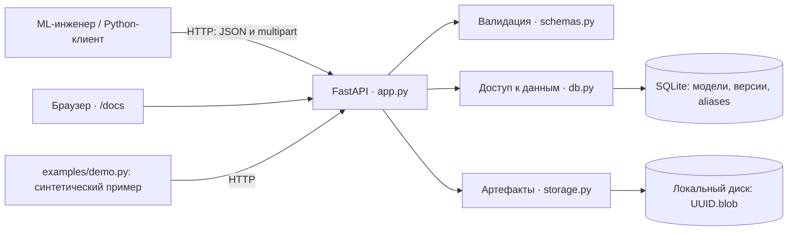
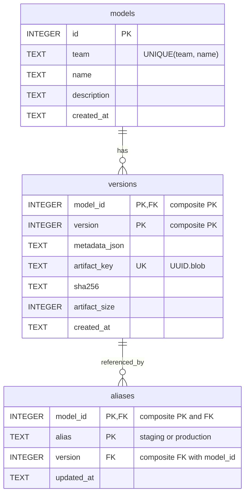

# Model registry: отчёт по проектированию

## 1. Задача и существующие проблемы

Несколько ML-команд сохраняют модели в произвольно названные каталоги на общей машине. Известны только пути; содержимое и происхождение моделей не описаны. Для домашней работы эта ситуация моделируется синтетическими файлами: доступа к исходной машине не требуется.

| Проблема | Последствие | Что требуется от registry |
|---|---|---|
| Имя папки пытается описать и модель, и эксперимент | Опечатки, неоднозначные версии, неудобный поиск | Разделить модель, версию и метаданные |
| Не зафиксирована команда-владелец | Непонятно, кто отвечает за результат | Явный namespace команды |
| Нет данных о датасете, коде и окружении | Нельзя установить происхождение результата | Обязательные поля происхождения |
| Метрики и параметры не сохранены | Версии нельзя содержательно сравнить | Структурированные metrics и parameters |
| Файлы можно незаметно перезаписать | По тому же пути окажется другая модель | Неизменяемые версии и контрольная сумма |
| Нет единого способа выбрать рабочую версию | Каждый потребитель хранит свой путь | Именованные указатели staging и production |
| Нет API и каталога | Интеграции зависят от обхода файловой системы | HTTP API, фильтры и документация |
| Всё находится на одной машине | Отказ диска может уничтожить данные | Явно описать ограничения и резервное копирование |

Название `with_rank_dataset_0` само по себе не доказывает, какой датасет использован. При переносе старых моделей владелец заполняет известные сведения; неизвестные значения явно обозначаются строкой `unknown`. Registry не восстанавливает потерянные сведения по названию каталога.

## 2. Объём и допущения

Реализуется небольшой учебный сервис: один хост, SQLite, локальный каталог артефактов, доверенные пользователи и доступ через `127.0.0.1`. Размер каждого принятого артефакта — от 1 байта до 10 MiB включительно (10 × 1024 × 1024 байт). Это выбранные ограничения проекта, а не характеристики исходной нагрузки.

Авторизации и аутентификации нет. Поле `team` группирует модели, но не разграничивает доступ: любой клиент сервиса может назначить alias любой модели. Нельзя считать такой сервис готовым общедоступным registry.

Обучение, инференс, развёртывание, согласования, управление датасетами и запуск экспериментов в систему не входят. `production` и `staging` — только изменяемые указатели на версии. Назначение `production` не разворачивает модель и не означает, что кто-либо подтвердил её качество.

Один артефакт — один непрозрачный для сервера файл. Для модели из нескольких файлов клиент заранее создаёт `.zip` или `.tar`. Сервер не распаковывает архивы, не импортирует библиотеки модели и не вызывает `pickle.load`.

## 3. Требования и критерии приёмки

### Функциональные требования

| ID | Требование | Критерий приёмки |
|---|---|---|
| F1 | Регистрировать модель с team, name, description | Дубликат `(team, name)` отклоняется; другая команда может использовать то же имя |
| F2 | Показывать каталог моделей | Работают точный фильтр team, подстрока name и limit/offset |
| F3 | Создавать последовательные версии внутри модели | Первые две загрузки дают версии 1 и 2; конкурентные загрузки не получают один номер |
| F4 | Сохранять метаданные каждой версии | Карточка возвращает framework, dataset_ref, code_ref, environment_ref, metrics, parameters, tags |
| F5 | Сохранять и отдавать артефакты | Скачанные байты совпадают с загруженными; SHA256 и размер доступны в карточке |
| F6 | Сохранять историю без перезаписи | API не содержит изменения или удаления версии и артефакта |
| F7 | Управлять staging/production | Alias разрешается в существующую версию той же модели; смена указателя не изменяет версии |
| F8 | Предоставлять понятные ошибки и описание API | Доступны `/docs`, `/openapi.json`; отсутствующий объект даёт 404 |
| F9 | Выявлять повреждение хранилища при скачивании | Отсутствующий или изменённый файл существующей версии даёт 409 |

### Нефункциональные требования

| ID | Требование | Критерий приёмки и граница |
|---|---|---|
| N1 | Простой локальный запуск | Python-приложение и локальные файлы; отдельные серверы БД и object storage не нужны |
| N2 | Данные переживают перезапуск приложения | После повторного запуска с тем же каталогом доступны модели, версии и aliases |
| N3 | Целостность связей | PK, UNIQUE и FOREIGN KEY предотвращают дубликаты и несуществующие ссылки |
| N4 | Корректные конкурентные записи | Выдача версии сериализована SQLite; ожидание блокировки ограничено 10 секундами |
| N5 | Ограниченный размер артефакта | Пустой файл отклоняется с 400, файл больше 10 MiB — с 413 |
| N6 | Безопасная адресация файлов | Путь строится из серверного UUID; имя файла клиента не используется как путь |
| N7 | Проверяемость | Автотесты используют отдельную временную БД и каталог; demo не требует исходных моделей |
| N8 | Честные эксплуатационные ограничения | Нет обещания SLA, высокой доступности или измеренного latency/throughput |

Метаданные проверяются по форме, но остаются декларациями автора: ссылка на код может устареть, а метрика может быть посчитана неверно. Даже заполненные поля не гарантируют воспроизводимость; SHA256 подтверждает соответствие байтов, а не качество модели.

Лимит файла проверяется при копировании из `UploadFile`. Разбор multipart выполняется раньше; этот лимит не заменяет ранние ограничения HTTP-запросов и защиту публичного сервиса от перегрузки.

## 4. Архитектура и выбор технологий



Компоненты находятся в одном приложении; стрелки к модулям не означают отдельные микросервисы. API принимает запрос, проверяет данные и координирует БД с файловым хранилищем. БД хранит небольшие записи и связи; файлы лежат отдельно и доступны только через API.

| Решение | Обоснование для этой работы | Когда пересмотреть |
|---|---|---|
| Python + FastAPI + Pydantic | Явные типы запросов и ответов, валидация, интерактивная документация; мало инфраструктурного кода | При иных требованиях команды к стеку |
| sqlite3 + SQL без ORM | Три небольшие таблицы; транзакции и запросы видны непосредственно в коде | При росте схемы или необходимости миграций |
| SQLite вместо PostgreSQL | Один хост и небольшой учебный сценарий; БД создаётся как файл | Несколько серверов приложения, значительная конкуренция записей, эксплуатационные требования |
| Локальная FS вместо S3 | Простая проверка хранения, checksum и обработки ошибок без внешнего аккаунта | Несколько хостов, крупные модели, отдельное масштабирование хранения |
| Собственная реализация вместо MLflow | Учебная цель — реализовать registry с нуля и разобрать его механизмы; MLflow не используется | В рабочем проекте сначала сравнить готовые продукты с требованиями |

Файл передаётся через `UploadFile`: FastAPI предоставляет файловый объект с промежуточным хранением в памяти или на диске. Приложение читает его частями. См. [официальное описание загрузки файлов](https://fastapi.tiangolo.com/tutorial/request-files/).

### Запись версии и обработка сбоев

1. Проверить модель и метаданные запроса.
2. Копировать файл частями во временный файл, подсчитывая размер и SHA256. При превышении лимита удалить временный файл.
3. Выполнить `fsync` файла, `os.replace` в окончательное имя `UUID.blob` на той же FS и `fsync` каталога на POSIX.
4. Открыть `BEGIN IMMEDIATE`, вычислить `MAX(version) + 1` для модели и вставить запись версии.
5. Зафиксировать транзакцию и вернуть карточку. При обычной ошибке SQL откатить транзакцию и удалить файл этого запроса.

`BEGIN IMMEDIATE` захватывает право записи до чтения последнего номера; другой писатель ждёт освобождения блокировки или получает ошибку по timeout. Файл готовится до транзакции, чтобы загрузка не удерживала блокировку БД. Механизм описан в [документации транзакций SQLite](https://www.sqlite.org/lang_transaction.html).

Общей транзакции между SQLite и FS нет. Если процесс аварийно завершится после публикации файла и до commit, останется файл без записи БД; возможны и остатки временных файлов. Автоматической очистки таких файлов в прототипе нет. Восстановление требует сопоставления файлов с `versions.artifact_key` при остановленных записях.

При скачивании сервер заново проверяет размер и SHA256. Файл буферизуется до ответа, поэтому затраты чтения и памяти — O(размер файла); это допустимо при учебном лимите 10 MiB. Обычная неизменяемость обеспечивается API; прямое редактирование каталога или БД администратором не запрещено технически.

Для резервной копии учебного сервиса следует остановить приложение и сохранить вместе БД и каталог артефактов. Автоматические backups, восстановление после потери диска и репликация не реализованы.

## 5. API

| Метод и путь | Вход | Результат |
|---|---|---|
| `POST /models` | JSON: `team`, `name`, необязательный `description` | Созданная модель с `id` |
| `GET /models` | Query: `team`, `name`, `limit`, `offset` | Список моделей с фильтрами |
| `GET /models/{id}` | ID модели | Карточка модели |
| `POST /models/{id}/versions` | Multipart: `metadata` — строка JSON; `artifact` — файл | Созданная версия |
| `GET /models/{id}/versions` | ID модели; query: `limit`, `offset` | Список её версий |
| `GET /models/{id}/versions/{version}` | ID модели и номер версии | Карточка версии |
| `GET /models/{id}/versions/{version}/artifact` | ID модели и номер версии | Байты проверенного артефакта |
| `PUT /models/{id}/aliases/{alias}` | JSON: `{"version": 2}`; alias — staging или production | Назначение указателя на версию |
| `GET /models/{id}/aliases/{alias}` | ID модели и alias | Карточка версии, на которую указывает alias |
| `GET /health` | — | Проверка API и чтения БД |
| `GET /docs`, `GET /openapi.json` | — | Интерфейс Swagger UI и схема API |

`team` и `name` состоят из строчных латинских букв, цифр, `_` и `-`, начинаются с буквы или цифры и имеют длину 1–64 символа. Поиск подстроки `name` чувствителен к регистру. Списки по умолчанию возвращают до 50 элементов; `limit` — от 1 до 100, `offset` — неотрицательный. Создание модели и версии возвращает `201`, успешные чтения и назначение alias — `200`.

Для загрузки метаданные передаются полем формы, потому что тело с файлом имеет тип `multipart/form-data`, а не отдельное JSON-body. См. [FastAPI: формы и файлы в одном запросе](https://fastapi.tiangolo.com/tutorial/request-forms-and-files/).

Минимальный осмысленный пример `metadata`:

```json
{
  "framework": "python-json",
  "dataset_ref": "synthetic:linear-demo-v1",
  "code_ref": "examples/demo.py",
  "environment_ref": "python-standard-library",
  "metrics": {"mae": 0.25},
  "parameters": {"slope": 2.0, "intercept": 1.0},
  "tags": ["demo"],
  "description": "Синтетическая линейная модель"
}
```

`framework`, `dataset_ref`, `code_ref`, `environment_ref` — обязательные строки; `unknown` разрешён как явное отсутствие знания. `metrics` — словарь конечных чисел, `parameters` — словарь JSON-значений, `tags` — список строк; эти коллекции могут быть пустыми. `description` необязателен.

Карточка версии содержит `model_id`, `version`, `metadata`, `sha256`, `artifact_size` и `created_at`. Ответ назначения alias содержит `model_id`, `alias`, `version` и `updated_at`. Внутренний путь `artifact_key` клиенту не нужен. Номер версии уникален только в пределах модели.

Основные ошибки: `400` — пустой артефакт; `404` — отсутствующая модель, версия или alias; `409` — конфликт имени либо отсутствующий/повреждённый файл зарегистрированной версии; `413` — превышение размера; `422` — некорректные параметры или метаданные. Ошибки доступности диска и SQLite возвращают `503`; иные неожиданные сбои остаются серверными ошибками.

Повторный POST загрузки создаёт новую версию, даже если байты совпадают. Идемпотентные ключи запросов и дедупликация не реализованы. При одновременных назначениях одного alias действует последняя успешно записанная версия указателя; истории назначений нет.

## 6. Схема БД



`models` описывает логическую модель команды. `versions` хранит каждую публикацию; её первичный ключ — `(model_id, version)`, внешний ключ `model_id` ссылается на `models.id`. `artifact_key` уникален и задаётся сервером.

`aliases` имеет первичный ключ `(model_id, alias)` и составной внешний ключ `(model_id, version)` на `versions`. Поэтому указатель не может ссылаться на отсутствующую версию или версию другой модели. Ограничение CHECK разрешает только `staging` и `production`.

На каждом соединении включается `PRAGMA foreign_keys = ON`; timeout ожидания SQLite — 10 секунд. Метаданные хранятся как JSON-текст после проверки Pydantic: разные модели имеют разные параметры и метрики. Фильтрация по содержимому JSON и сложная аналитика в текущий API не входят. Точная DDL-схема находится в `registry/schema.sql`.

## 7. Реализация и проверка

HTTP-обработчики находятся в `registry/app.py`, валидация — в `registry/schemas.py`, SQL — в `registry/db.py`, работа с файлами — в `registry/storage.py`. `examples/demo.py` создаёт синтетическую линейную модель в JSON, вычисляет демонстрационную MAE и обращается к API. Сам registry модель не исполняет.

Проверено 10 октября 2026 года на Python 3.14.2: `python -m pytest -q` — **26 passed**. Тесты покрывают полный цикл загрузки и скачивания, изоляцию namespace, конкурентную выдачу номеров, переключение и откат alias, пагинацию, невалидные метаданные, лимит размера, повреждение файлов и сохранность после перезапуска. Проверка отказа commit выполняет настоящий INSERT внутри транзакции, затем подтверждает откат строки и удаление нового файла при сохранности старой версии. Starlette выдаёт одно предупреждение об устаревании текущего backend TestClient; тесты проходят.

Дополнительно выполнен `examples/demo.py` против настоящего Uvicorn-сервера на localhost: зарегистрированы v1/v2, MAE на синтетических тестовых данных составила 8.0/0.0, production переключён на v2, SHA256 скачанного файла совпал. Клиент получил прогноз 21.0 для x=10. `python -m pip check` не обнаружил конфликтов зависимостей. Это функциональная проверка учебного сценария, а не нагрузочный тест.

Инструкции запуска находятся в `README.md`; разбор кода — в `docs/walkthrough.md`. Для сдачи следует приложить этот отчёт и ссылку на опубликованный Git-репозиторий с кодом и тестами. Публикация репозитория выполняется отдельно от локальной реализации.
